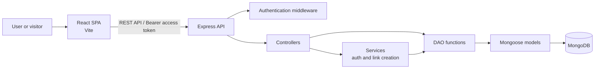
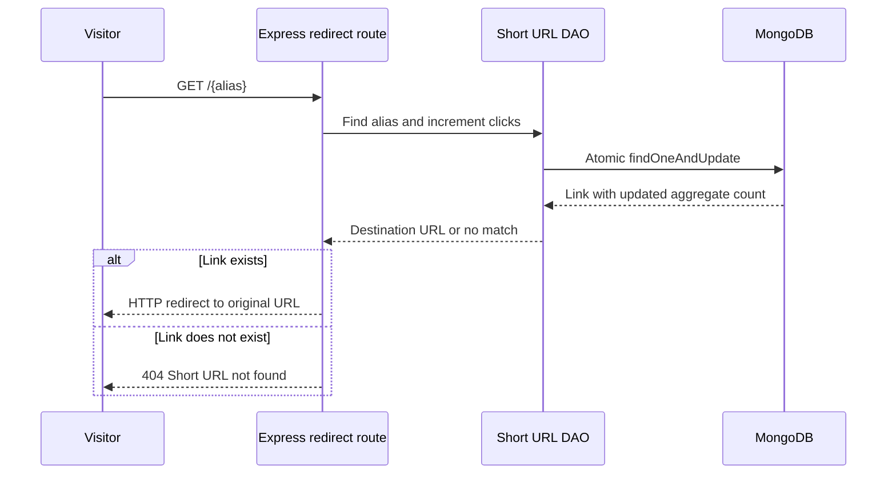
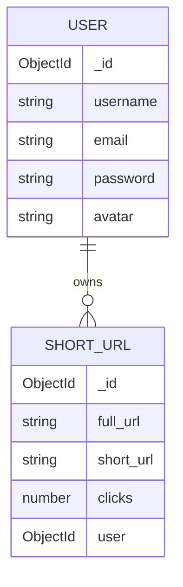
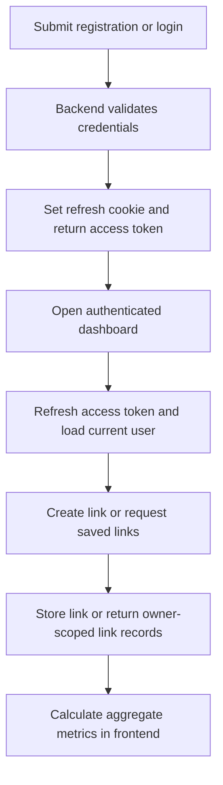

# SnipURL

**Shorten links. Track journeys. Understand your audience.**

SnipURL is a full-stack URL shortener with a React dashboard and an Express API. Create compact links, optionally choose an alias when signed in, manage your saved links, and review aggregate click counts.

[](https://react.dev/)
[](https://vite.dev/)
[](https://tailwindcss.com/)
[](https://expressjs.com/)
[](https://mongoosejs.com/)

[Repository](https://github.com/TufailMd/SnipURL) · [Author](https://github.com/TufailMd)

## Table of Contents

- [Project Overview](#project-overview)
- [Screenshots and Demo](#screenshots-and-demo)
- [Features](#features)
- [Technology Stack](#technology-stack)
- [System Architecture](#system-architecture)
- [Project Structure](#project-structure)
- [Getting Started](#getting-started)
- [Environment Variables](#environment-variables)
- [API Reference](#api-reference)
- [Database Design](#database-design)
- [Application Workflows](#application-workflows)
- [Security](#security)
- [Deployment](#deployment)
- [Roadmap](#roadmap)
- [Contributing](#contributing)
- [License](#license)
- [Author](#author)

## Project Overview

SnipURL turns long destination URLs into shorter links that redirect visitors to the original address. Short links are easier to share and can be associated with an account, making it possible to review saved links and their total click counts from a dashboard.

The project is a practical full-stack example: a Vite-powered React SPA communicates with an Express REST API, MongoDB stores users and links, and route middleware separates public link creation and redirects from authenticated account features. The analytics shown today are based on aggregate click counters; the backend does not record individual click events.

## Screenshots and Demo

Screenshots have not been added to the repository yet. Replace the placeholders below with real captures when available.

| Screen         | Preview                 |
| -------------- | ----------------------- |
| Landing Page   | Screenshot not provided |
| Authentication | Screenshot not provided |
| Dashboard      | Screenshot not provided |
| My Links       | Screenshot not provided |
| Analytics      | Screenshot not provided |

**Live demo:** No deployed application URL is configured in the repository.

## Features

### URL management

- Create a short URL from a valid `http://` or `https://` destination.
- Generate a seven-character Nano ID alias by default.
- Signed-in users can provide an optional unique custom alias of 3–64 letters, numbers, hyphens, or underscores.
- Redirect short-link visits to the original destination and increment the link's aggregate click counter.
- Copy short links from the creation form, dashboard, and link list.
- Create links without an account. Anonymous links are not associated with a user account and therefore do not appear in an account's saved-link list.
- The current API supports creating and listing links; it does not provide link edit or delete endpoints.

### Authentication

- Register with a username, email address, and password.
- Log in and log out.
- Use short-lived access JWTs and a refresh JWT stored in an HTTP-only cookie.
- Refresh the access token when an authenticated dashboard route is loaded.
- Registration and sign-in validate required values; registration enforces a 2–80 character username, a valid email format, and a password of at least eight characters.

### Dashboard and My Links

- View account-specific saved links, total link count, aggregate clicks, recent links, and top links.
- Search saved links by short URL or destination, sort by click count, refresh the list, paginate locally, and export the filtered list as CSV.
- Copy a short URL or open its destination from the links workspace.
- Use a responsive dashboard with a mobile menu and bottom navigation.

### Analytics

- See total aggregate clicks and a top-performing links ranking for account-owned links.
- Export link-level short URL, destination, and total click data as CSV or JSON.
- Time-series charts, daily metrics, unique visitors, device breakdowns, and geographic data are **not available**: the API stores only a total click count per link, not individual click events or visitor attributes.

## Technology Stack

| Category                 | Technology                                  | Purpose                                                            |
| ------------------------ | ------------------------------------------- | ------------------------------------------------------------------ |
| Frontend                 | React 19, JavaScript, Vite 6                | Single-page user interface and development/build tooling           |
| Client routing and state | TanStack Router, Redux Toolkit, React Redux | Route navigation, authentication state, and route guards           |
| Data fetching            | TanStack Query, Axios                       | API requests and client-side query caching                         |
| Styling                  | Tailwind CSS 4, `@tailwindcss/vite`         | Responsive interface styling                                       |
| Backend                  | Node.js, Express 5 (ES modules)             | HTTP API, redirect handling, and business logic                    |
| Database                 | MongoDB, Mongoose 8                         | Persist users and shortened URLs                                   |
| Authentication           | `jsonwebtoken`, `bcryptjs`, `cookie-parser` | Signed access/refresh tokens, password hashing, and cookie parsing |
| Short ID generation      | `nanoid`                                    | Generate default short-link aliases                                |
| Hosting                  | Not configured                              | No deployment platform or deployment manifests are present         |

## System Architecture

The browser application calls the Express API. Controllers handle HTTP requests, services implement authentication and link-creation rules, and DAO functions read and write Mongoose models in MongoDB. User-link retrieval and short-link redirection call DAO functions directly from their controllers.



### Short-link redirect flow



## Project Structure

```text
SnipURL/
├── backend/
│   ├── .env.example
│   ├── .gitignore
│   ├── app.js
│   ├── package-lock.json
│   ├── package.json
│   └── src/
│       ├── config/
│       │   ├── config.js
│       │   └── db.config.js
│       ├── controller/
│       │   ├── auth.controller.js
│       │   ├── short_url.controller.js
│       │   └── user.controller.js
│       ├── dao/
│       │   ├── short_url.js
│       │   └── user.dao.js
│       ├── middleware/
│       │   └── auth.middleware.js
│       ├── models/
│       │   ├── short_url.model.js
│       │   └── user.model.js
│       ├── routes/
│       │   ├── auth.routes.js
│       │   ├── short_url.route.js
│       │   └── user.route.js
│       ├── services/
│       │   ├── auth.service.js
│       │   └── short_url.service.js
│       └── utils/
│           ├── error.middleware.js
│           ├── helper.js
│           ├── responseHandler.js
│           └── tryCatchWrapper.js
└── frontend/
    ├── .env.example
    ├── .gitignore
    ├── eslint.config.js
    ├── index.html
    ├── package-lock.json
    ├── package.json
    ├── public/
    ├── vite.config.js
    └── src/
        ├── App.css
        ├── RootLayout.jsx
        ├── index.css
        ├── main.jsx
        ├── queryClient.js
        ├── api/
        │   ├── shortUrl.api.js
        │   └── user.api.js
        ├── app/
        │   ├── store.js
        │   └── slice/
        │       └── authSlice.js
        ├── assets/
        ├── components/
        │   ├── auth/
        │   ├── dashboard/
        │   └── landing/
        ├── pages/
        │   ├── AnalyticsPage.jsx
        │   ├── AuthPage.jsx
        │   ├── DashboardPage.jsx
        │   ├── HomePage.jsx
        │   ├── LandingPage.jsx
        │   └── MyLinksPage.jsx
        ├── routing/
        │   ├── analytics.js
        │   ├── auth.route.js
        │   ├── dashboard.js
        │   ├── homepage.js
        │   ├── my-links.js
        │   ├── root.route.js
        │   └── routeTree.js
        └── utils/
            ├── axiosInstance.js
            └── helper.js
```

- `frontend/src/components/` contains reusable landing, authentication, and dashboard UI.
- `frontend/src/pages/` contains the landing, authentication, dashboard, My Links, and Analytics screens.
- `frontend/src/routing/` defines TanStack Router routes and authenticated dashboard guards.
- `frontend/src/api/` contains client calls to the backend; `frontend/src/utils/` configures Axios and route authentication helpers.
- `frontend/src/app/` holds the Redux store and authentication slice.
- `backend/src/routes/` maps API paths to controllers; `backend/src/controller/` handles requests and responses.
- `backend/src/services/` contains authentication and short-link creation logic; `backend/src/dao/` performs database operations.
- `backend/src/models/` defines Mongoose schemas; `backend/src/middleware/` contains bearer-token authentication.
- `backend/src/config/` loads required settings and connects to MongoDB; `backend/src/utils/` contains token helpers, response utilities, async wrappers, and error handling.

## Getting Started

### Prerequisites

- Node.js and npm (use a Node.js release supported by the installed Vite and Express dependencies).
- MongoDB, either a local instance or a MongoDB connection string.
- Git.

### Clone the repository

```bash
git clone https://github.com/TufailMd/SnipURL.git
cd SnipURL
```

### Configure the environment

In PowerShell, create local environment files from the examples:

```powershell
Copy-Item backend\.env.example backend\.env
Copy-Item frontend\.env.example frontend\.env
```

Edit both files with the local values shown under [Environment Variables](#environment-variables). The checked-in examples use example hostnames; replace them before starting the application.

### Install dependencies

There is no root-level package manifest, so install each application separately:

```powershell
Set-Location backend
npm install

Set-Location ..\frontend
npm install
```

### Start MongoDB

Start your local MongoDB service or configure `MONGO_URI` to point to a reachable MongoDB instance. The backend connects to the configured database during startup and exits if it cannot connect.

### Start the backend

In a terminal:

```powershell
Set-Location backend
npm run dev
```

The backend listens on `PORT` (default `3000`).

### Start the frontend

In another terminal:

```powershell
Set-Location frontend
npm run dev
```

Vite prints its local development address (typically `http://localhost:5173`). Ensure `FRONTEND_URL` in the backend environment exactly matches that origin.

### Available scripts

| Package  | Command           | Description                                                      |
| -------- | ----------------- | ---------------------------------------------------------------- |
| Backend  | `npm start`       | Start Express with Node.js                                       |
| Backend  | `npm run dev`     | Start Express using Nodemon                                      |
| Backend  | `npm test`        | Not configured; the script exits with “Error: no test specified” |
| Frontend | `npm run dev`     | Start the Vite development server                                |
| Frontend | `npm run build`   | Create the production build in `frontend/dist/`                  |
| Frontend | `npm run preview` | Preview the production build locally                             |
| Frontend | `npm run lint`    | Run ESLint                                                       |

## Environment Variables

The backend loads its environment from `backend/.env`; Vite exposes `VITE_API_URL` to the frontend at build/dev time. Never commit real secrets or credentials.

### Backend: `backend/.env`

```dotenv
MONGO_URI=mongodb://127.0.0.1:27017/snipurl
JWT_SECRET=replace-with-a-long-random-secret
APP_URL=http://localhost:3000
FRONTEND_URL=http://localhost:5173
PORT=3000
NODE_ENV=development
```

| Variable       | Required    | Purpose                                                              |
| -------------- | ----------- | -------------------------------------------------------------------- |
| `MONGO_URI`    | Yes         | MongoDB connection URI                                               |
| `JWT_SECRET`   | Yes         | Secret used to sign and verify JWTs                                  |
| `APP_URL`      | Yes         | Backend base URL used when returning a newly created short URL       |
| `FRONTEND_URL` | Recommended | Allowed CORS origin for the frontend; requests include credentials   |
| `PORT`         | No          | Express listen port; defaults to `3000`                              |
| `NODE_ENV`     | No          | Controls whether refresh cookies use the `Secure` flag in production |

### Frontend: `frontend/.env`

```dotenv
VITE_API_URL=http://localhost:3000
```

`VITE_API_URL` is the backend base URL used by Axios. For deployments, set it to the deployed backend origin before building the frontend.

## API Reference

The API is served by the backend origin. Examples below assume `http://localhost:3000`. Endpoints are based on the Express route registrations in `backend/app.js`.

### Authentication

| Method | Endpoint             | Description                                                                | Authentication           |
| ------ | -------------------- | -------------------------------------------------------------------------- | ------------------------ |
| `POST` | `/api/auth/register` | Register a user; returns an access token and sets the refresh-token cookie | Public                   |
| `POST` | `/api/auth/login`    | Sign in; returns an access token and sets the refresh-token cookie         | Public                   |
| `POST` | `/api/auth/refresh`  | Rotate refresh token and return a new access token                         | Refresh-token cookie     |
| `POST` | `/api/auth/logout`   | Clear the refresh-token cookie                                             | No bearer token required |
| `GET`  | `/api/auth/me`       | Return the authenticated user's profile                                    | Bearer access token      |

Registration request:

```json
{
  "username": "sam",
  "email": "sam@example.com",
  "password": "a-long-password"
}
```

Successful registration response (`201`; a refresh cookie is also set):

```json
{
  "success": true,
  "message": "User registered successfully",
  "user": {
    "username": "sam",
    "email": "sam@example.com"
  },
  "accessToken": "<access-jwt>"
}
```

Login uses `email` and `password` in the request body and returns the same response shape with the message `"User logged in successfully"`.

Current-user response:

```json
{
  "user": {
    "_id": "<user-id>",
    "username": "sam",
    "email": "sam@example.com",
    "avatar": "<gravatar-url>"
  }
}
```

### URL management

| Method | Endpoint      | Description                                                      | Authentication               |
| ------ | ------------- | ---------------------------------------------------------------- | ---------------------------- |
| `POST` | `/api/create` | Create a short URL; alias is accepted for authenticated users    | Optional bearer access token |
| `GET`  | `/{alias}`    | Increment the link's click count and redirect to its destination | Public                       |

Create-link request:

```json
{
  "url": "https://example.com/a/long/path",
  "slug": "docs"
}
```

The `slug` field is optional. For an authenticated request, an alias must be 3–64 characters and contain only letters, numbers, hyphens, or underscores. Without a signed-in user, the API generates a Nano ID alias. A successful response is the short URL as plain text, for example:

```text
http://localhost:3000/Ab12xyz
```

The `GET /{alias}` route responds with a redirect to the saved destination. If the alias does not exist, the API returns a `404` error.

### User management

| Method | Endpoint         | Description                                | Authentication      |
| ------ | ---------------- | ------------------------------------------ | ------------------- |
| `POST` | `/api/user/urls` | List links owned by the authenticated user | Bearer access token |

This endpoint has no request body. Its response contains Mongoose link records:

```json
{
  "message": "success",
  "urls": [
    {
      "_id": "<link-id>",
      "full_url": "https://example.com/a/long/path",
      "short_url": "docs",
      "clicks": 4,
      "user": "<user-id>"
    }
  ]
}
```

### Analytics

There is no dedicated analytics endpoint. The authenticated link-list endpoint returns each saved link's aggregate `clicks` value. The frontend derives total clicks and rankings from that list. Click timestamps, visitor identity, device, and geography are not stored.

### Error responses

The shared error handler returns an error object in this form (stack traces are included only in development):

```json
{
  "success": false,
  "status": "fail",
  "message": "A valid http:// or https:// destination URL is required"
}
```

## Database Design

MongoDB stores two Mongoose models. The `user` reference on a short URL is optional, allowing links created without authentication.

| Model      | Field       | Type                          | Constraints / purpose                                        |
| ---------- | ----------- | ----------------------------- | ------------------------------------------------------------ |
| `users`    | `username`  | String                        | Required and unique                                          |
| `users`    | `email`     | String                        | Required and unique; normalized to lowercase on registration |
| `users`    | `password`  | String                        | Required; stores the bcryptjs hash                           |
| `users`    | `avatar`    | String                        | Defaults to a Gravatar identicon URL derived from the email  |
| `shortUrl` | `full_url`  | String                        | Required original destination                                |
| `shortUrl` | `short_url` | String                        | Required, unique, indexed alias                              |
| `shortUrl` | `clicks`    | Number                        | Aggregate counter, defaults to `0`                           |
| `shortUrl` | `user`      | ObjectId reference to `users` | Optional owner reference                                     |

Mongoose also supplies `_id` and `__v`. The schemas do not configure timestamps.



Because `SHORT_URL.user` is optional, a short URL may also exist without a related user.

## Application Workflows

### Registration and login

1. The frontend submits registration or login credentials to the auth API.
2. The backend validates the request; registration hashes the password with bcryptjs (12 rounds), while login compares the supplied password with the stored hash.
3. The backend returns a 15-minute access JWT and sets a seven-day refresh JWT in an HTTP-only cookie.
4. The frontend keeps the access token in the Axios client's in-memory authorization header. Authenticated route checks call the refresh endpoint and then load the current user.

### Creating a short URL

1. A user submits a destination URL, and optionally an alias.
2. The backend accepts only `http:` and `https:` destinations.
3. An authenticated request may use a validated, unique custom alias; otherwise, the backend generates a seven-character Nano ID.
4. The link is stored in MongoDB, associated with the authenticated user when present, and its short URL is returned.

### Visiting a short URL and tracking clicks

1. A visitor opens `/{alias}` on the backend host.
2. The backend looks up the alias and atomically increments its `clicks` field.
3. If found, the visitor is redirected to `full_url`; if not found, a not-found error is returned.

### Viewing links and analytics

1. The authenticated dashboard requests `/api/user/urls`.
2. The API filters records by the authenticated user's ID.
3. The dashboard and Analytics page calculate totals and rankings from each returned link's aggregate click count. My Links also provides local search, sorting, pagination, and CSV export; Analytics offers CSV and JSON exports.



## Security

Implemented controls include:

- Passwords are hashed with `bcryptjs` using 12 salt rounds.
- Access and refresh tokens are signed JWTs with distinct token types and expirations (15 minutes and seven days, respectively).
- The refresh JWT is set as an HTTP-only cookie, with `Secure` enabled when `NODE_ENV=production`; CORS is configured for the `FRONTEND_URL` origin and credentials.
- The refresh cookie uses `SameSite=Lax` when set.
- Authenticated API middleware verifies bearer access tokens and resolves the user from MongoDB. Link listing is scoped to the authenticated user's ID.
- Link destinations are limited to HTTP and HTTPS. Custom aliases are constrained by a character/length rule and protected by a unique database index.
- Express JSON and URL-encoded request bodies are limited to 16 KB, and the `X-Powered-By` header is disabled.

The repository does not configure API rate limiting. Logout clears the browser's refresh cookie; no server-side refresh-token revocation store is implemented.

### Backend

1. Deploy the `backend/` Node.js application and install its dependencies.
2. Configure `MONGO_URI`, a strong private `JWT_SECRET`, `APP_URL` (the publicly reachable backend base URL), `FRONTEND_URL` (the exact frontend origin), `PORT` if required by the host, and `NODE_ENV=production`.
3. Start with `npm start`. The process connects to MongoDB before opening its HTTP listener.
4. Ensure the hosting platform routes requests for `/{alias}` to Express as well as `/api/*`.

### Frontend

1. Set `VITE_API_URL` to the deployed backend origin before running the production build.
2. From `frontend/`, run `npm install` and `npm run build`.
3. Publish the contents of `frontend/dist/` on a static host configured to serve the SPA routes.
4. Update backend `FRONTEND_URL` to the deployed frontend origin. Because Vite embeds `VITE_API_URL` in the build, rebuild after changing it.

Use HTTPS in production so the refresh cookie's `Secure` option can be applied. No live deployment URL is currently documented.

## Roadmap

The following are potential improvements, not features currently provided by the API:

- Record click timestamps and build time-series analytics.
- Add device and geographic analytics with appropriate privacy controls.
- Add link expiration and password-protected links.
- Generate QR codes and support custom domains.
- Add API rate limiting and server-side refresh-token revocation.
- Add team workspaces and shared link management.

## Contributing

Contributions are welcome:

1. Fork the repository.
2. Create a focused feature branch.
3. Make the change and update relevant documentation.
4. Run the frontend checks: `npm run lint` and `npm run build` from `frontend/`. The backend currently has no configured test suite.
5. Submit a pull request describing the change and how it was verified.

## License

There is no repository-level `LICENSE` file, so the project's reuse and redistribution terms have not been specified in a license document. Although `backend/package.json` contains `ISC` package metadata, confirm the intended repository license with the owner before relying on it.

## Author

**Tufail Md** · [GitHub Profile](https://github.com/TufailMd)
